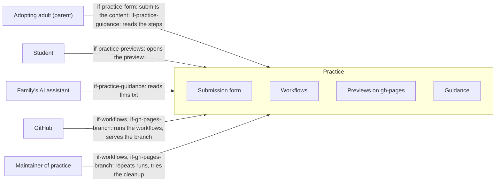

# System Scope and Context

The system is the repository `lernapps/practice`: the form, the workflows, the actions and the site below which the
previews live. The [architecture of the whole system](https://lernapps.net/docs/architecture/) shows it as one
building block and names its neighbours; here the same neighbours are seen from inside.

Outside the system are the people who use it, the assistant that prepares the content and the systems it runs on or
takes parts from. The parent, the child and the family's assistant use the form, the previews and the guidance.
GitHub runs the workflows, stores the issues and their attachments and serves the branch `gh-pages`. Maintainers
repeat runs and look after the settings. Neighbours supply what the system does not hold; they are black boxes in
chapter 5: the explainer template (lernapps/app-templates), the checks and shared site actions (lernapps/tooling), the
site frame (lernapps.github.io) and the catalog (lernapps/apps), which the guide sends the assistant to first.

## Context overview

```arc42
:::diagram
id: context-overview
view: context
notation: mermaid
:::
```



## Neighbours that supply parts

The system takes parts from the neighbours below; each is a black box in chapter 5, with the interface the system uses.

| Neighbour | What the system takes | Interface |
|---|---|---|
| App templates (lernapps/app-templates) | The explainer template and its runtime, at the commit that `appTemplates.commit` pins; the schema and README the guide links to | `if-archetypes` |
| Tooling (lernapps/tooling) | `lernapps check` for the bundle, through the template's lock file; the shared site actions and the change classifier for the site | `if-tooling-cli`, `if-site-actions` |
| Website (lernapps.github.io) | The site frame: header, footer, language switch and the check of the site rules | `if-site-frame` |
| Catalog (lernapps/apps) | The first place the guide sends the assistant to; nothing is read from it | `if-catalog-pages` |

## Adopting adult

The parent of a child with a test coming up. They have a GitHub account, take the content from their assistant, submit
it with the form and give the address of the preview to the child.

```arc42
:::actor
id: actor-adopting-adult
title: Adopting adult
type: person
description: A parent who submits the content their assistant wrote and passes the address on to the child
requires: if-practice-form, if-practice-guidance
:::
```

## Student

The child. It opens the preview and practises; it signs up for nothing and installs nothing. What the app remembers
stays in its browser.

```arc42
:::actor
id: actor-student
title: Student
type: person
description: The child who practises with the preview
requires: if-practice-previews
:::
```

## Family's AI assistant

The assistant the family already has. It looks in the catalog first, reads the photos of the material (these go to the
assistant's provider only, never to the system), agrees the scope with the parent and the child and writes the content
of an explainer. It reads the guide and gives the parent a ZIP file and the link to the form.

```arc42
:::actor
id: actor-family-assistant
title: Family's AI assistant
type: system
description: Any assistant that reads llms.txt; prepares the content and hands it to the parent
requires: if-practice-guidance
:::
```

## GitHub

Stores the issues and their attachments, starts the workflows on their events, runs them on its runners and serves the
branch `gh-pages` through Pages. It is also the means of production of the platform as a whole.

```arc42
:::actor
id: actor-github
title: GitHub
type: system
description: Issues, attachments, Actions and Pages
requires: if-workflows, if-gh-pages-branch, if-practice-form
:::
```

## Maintainer of practice

A person with write access to the repository. They repeat the run for an issue without a new attachment, start the
cleanup as a dry run first, close or lock issues that are plainly abuse, and keep the settings (Pages from the branch
`gh-pages`, required checks).

```arc42
:::actor
id: actor-practice-maintainer
title: Maintainer of practice
type: person
description: Repeats runs, tries and starts the cleanup, closes abusive issues, keeps the settings
requires: if-workflows, if-gh-pages-branch
:::
```
