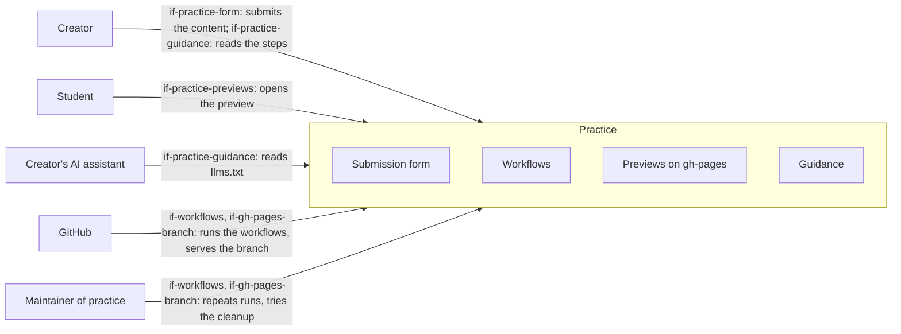

# System Scope and Context

The system is the repository `lernapps/practice`: the form, the workflows, the actions and the site below which the
previews live. The [architecture of the whole system](https://lernapps.net/docs/architecture/) shows it as one
building block and names its neighbours; here the same neighbours are seen from inside.

Outside the system are the people who use it, the assistant that prepares the content and the systems it runs on or
takes parts from. The neighbours are black boxes in chapter 5.

## Context overview

```arc42
:::diagram
id: context-overview
view: context
notation: mermaid
:::
```



## Neighbours that supply parts

The interface is the one the system uses.

| Neighbour | What the system takes | Interface |
|---|---|---|
| App templates (lernapps/app-templates) | The explainer template and its runtime, at the commit that `appTemplates.commit` pins; the schema and README the guide links to | `if-archetypes` |
| Tooling (lernapps/tooling) | `lernapps check` for the bundle, through the template's lock file; the shared site actions and the change classifier for the site | `if-tooling-cli`, `if-site-actions` |
| Website (lernapps.github.io) | The site frame: header, footer, language switch and the check of the site rules | `if-site-frame` |
| Catalog (lernapps/apps) | The first place the guide sends the assistant to; nothing is read from it | `if-catalog-pages` |

## Creator

The person who submits (chapter 1). They submit the content with the form and give the address to the student.

```arc42
:::actor
id: actor-creator
title: Creator
type: person
description: The person who submits the content their assistant wrote and passes the address on to the student
requires: if-practice-form, if-practice-guidance
:::
```

## Student

The learner. It opens the preview and practises.

```arc42
:::actor
id: actor-student
title: Student
type: person
description: The learner who practises with the preview
requires: if-practice-previews
:::
```

## Creator's AI assistant

The assistant the creator already has. It reads the guide, writes the content and gives the creator a ZIP file and the
link to the form. The photos of the material go to the assistant's provider only, never to the system.

```arc42
:::actor
id: actor-ai-assistant
title: Creator's AI assistant
type: system
description: Any assistant that reads llms.txt; prepares the content and hands it to the creator
requires: if-practice-guidance
:::
```

## GitHub

Stores the issues, runs the workflows and serves the branch `gh-pages` through Pages (`con-github`).

```arc42
:::actor
id: actor-github
title: GitHub
type: system
description: Issues, attachments, Actions and Pages
requires: if-workflows, if-gh-pages-branch, if-practice-form
:::
```

## Maintainer of practice

A person with write access to the repository. They repeat runs, try the cleanup, close abusive issues and keep the
settings (`docs/betrieb.md`).

```arc42
:::actor
id: actor-practice-maintainer
title: Maintainer of practice
type: person
description: Repeats runs, tries and starts the cleanup, closes abusive issues, keeps the settings
requires: if-workflows, if-gh-pages-branch
:::
```
