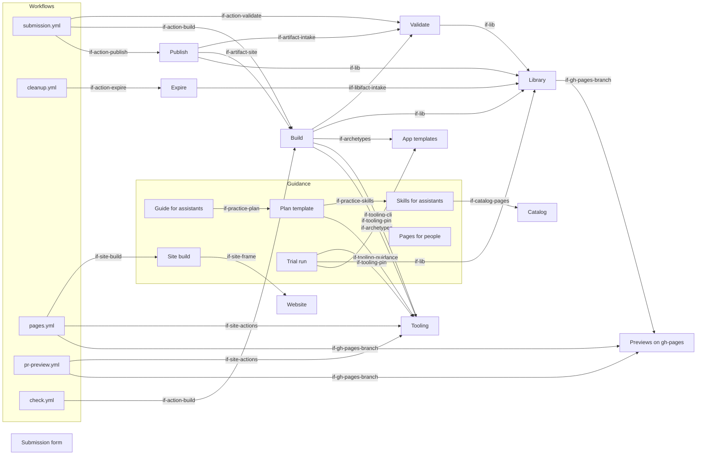

# Building Blocks

The repository holds the form, the workflows that run a submission and a cleanup, the actions with the logic, the
guidance and the site the previews live below. Neighbours supply the rest; they are black boxes here, and the
[architecture of the whole system](https://lernapps.net/docs/architecture/) names them. The blocks refine its building
block "Practice" and keep the interface names `if-practice-form`, `if-practice-previews` and `if-practice-guidance`.
Paths are relative to the root of `lernapps/practice`; the source of each block is the reference for its details.

## Level 1

The flow runs from the form through the workflows and actions to the branch `gh-pages`; artifacts pass between the actions as data.

```arc42
:::ignore H018 one picture shows the flow from the form to the branch, with the groups drawn around their parts :::
:::diagram
id: building-blocks-level-1
view: building-block
notation: mermaid
:::
```



## Submission form

The GitHub issue form with subject, grade, federal state, the ZIP file and the declarations. Its field ids and lists are fixed and checked by a test.

```arc42
:::building-block
id: bb-form
title: Submission form
technology: GitHub issue form (YAML)
path: .github/ISSUE_TEMPLATE
:::
```

### Form interface

The fields of the form and the attachment; the comments that answer in the same issue.

```arc42
:::interface
id: if-practice-form
title: Submission form
provider: bb-form
protocol: GitHub issue form with the content as a ZIP attachment; results as comments on the issue
path: .github/ISSUE_TEMPLATE/submit.yml
:::
```

## Workflows

The files GitHub reads to start work. Each names a trigger, the rights of its jobs and the actions to call.

```arc42
:::building-block
id: bb-workflows
title: Workflows
technology: GitHub Actions workflows (YAML)
path: .github/workflows
:::
```

### Workflow events

What GitHub and the maintainers use to start the workflows.

```arc42
:::interface
id: if-workflows
title: Workflow events
provider: bb-workflows
protocol: GitHub events issues opened, edited and closed, issue comments created and edited, a daily schedule, workflow_dispatch with an issue number
path: .github/workflows
:::
```

### Submission workflow

`submission.yml`. Runs the jobs `intake`, `build` and `publish` one after the other for an issue that was opened or edited, for a comment of the issue's author with an attachment (`term-latest-upload`), or by hand for an issue number (`concept-rights-split`).

```arc42
:::building-block
id: bb-workflow-submission
title: Submission workflow
technology: GitHub Actions workflow
parent: bb-workflows
path: .github/workflows/submission.yml
requires: if-action-validate, if-action-build, if-action-publish
implements: concept-rights-split
:::
```

### Cleanup workflow

`cleanup.yml`. Runs the cleanup daily, when an issue is closed and by hand (`concept-temporary-preview`).

```arc42
:::building-block
id: bb-workflow-cleanup
title: Cleanup workflow
technology: GitHub Actions workflow
parent: bb-workflows
path: .github/workflows/cleanup.yml
requires: if-action-expire
implements: concept-temporary-preview
:::
```

### Pages workflow

`pages.yml`. Builds and checks the site and, on the main line, publishes it to the root of `gh-pages` with the shared site actions.

```arc42
:::building-block
id: bb-workflow-pages
title: Pages workflow
technology: GitHub Actions workflow
parent: bb-workflows
path: .github/workflows/pages.yml
requires: if-site-actions, if-site-build, if-gh-pages-branch
:::
```

### Pull request preview workflow

`pr-preview.yml`. A preview of the site for each pull request from the same repository, below `pr-preview/`.

```arc42
:::building-block
id: bb-workflow-pr-preview
title: Pull request preview workflow
technology: GitHub Actions workflow
parent: bb-workflows
path: .github/workflows/pr-preview.yml
requires: if-site-actions, if-gh-pages-branch
:::
```

### Check workflow

`check.yml`. Runs the tests, a smoke build of a fixture and the lint of the workflows; its job `check` is the one to require.

```arc42
:::building-block
id: bb-workflow-check
title: Check workflow
technology: GitHub Actions workflow, node:test, actionlint
parent: bb-workflows
path: .github/workflows/check.yml
requires: if-action-build
:::
```

## Actions

Local composite actions that hold the logic of a submission. Each has an `action.yml` and one TypeScript script, and shares the library.

## Validate

The intake. Reads the issue, downloads the attachment and checks and unpacks it into a throwaway folder (`concept-bounded-input`). Writes nothing to GitHub.

```arc42
:::building-block
id: bb-action-validate
title: Validate
technology: Composite action, TypeScript (actions/validate)
path: actions/validate
requires: if-lib
implements: concept-bounded-input
:::
```

### Validate interface

How a workflow calls the intake.

```arc42
:::interface
id: if-action-validate
title: Validate action
provider: bb-action-validate
protocol: Composite action; inputs and outputs in action.yml
path: actions/validate/action.yml
:::
```

### Intake artifact

What the intake hands on: the verdict and, for a valid submission, the unpacked files.

```arc42
:::interface
id: if-artifact-intake
title: Intake artifact
provider: bb-action-validate
protocol: Workflow artifact intake: the verdict always, the unpacked files for a valid submission
path: actions/validate/validate.ts
:::
```

## Build

Builds the app from the template at the tooling's pin and the submitted tree, runs the components' tests and the explainer's build, which checks content and component code, and checks the bundle with `lernapps check`. It runs submitted code, so it has no secret and no right to write (`dec-content-and-components`).

```arc42
:::building-block
id: bb-action-build
title: Build
technology: Composite action, TypeScript (actions/build), npm, Playwright via lernapps check
path: actions/build
requires: if-lib, if-artifact-intake, if-archetypes, if-tooling-cli, if-tooling-pin
:::
```

### Build interface

How a workflow calls the build.

```arc42
:::interface
id: if-action-build
title: Build action
provider: bb-action-build
protocol: Composite action; reads the artifact intake and the pin of lernapps/tooling on main
path: actions/build/action.yml
:::
```

### Site artifact

What the build hands on: the bundle when the build passed, and the head of its log always.

```arc42
:::interface
id: if-artifact-site
title: Site artifact
provider: bb-action-build
protocol: Workflow artifacts site (the bundle, only when the build passed) and build (the log)
path: actions/build/build.ts
:::
```

## Publish

The last job. Treats the artifacts as data, checks the site again, writes `i/<issue>/` and `practice.json` to `gh-pages` and updates the one comment of the issue. Turns a rejection or a failed build into that comment.

```arc42
:::building-block
id: bb-action-publish
title: Publish
technology: Composite action, TypeScript (actions/publish)
path: actions/publish
requires: if-lib, if-artifact-intake, if-artifact-site
implements: concept-rights-split, concept-temporary-preview
:::
```

### Publish interface

How a workflow calls the last job.

```arc42
:::interface
id: if-action-publish
title: Publish action
provider: bb-action-publish
protocol: Composite action; reads the artifacts; writes gh-pages and the comment
path: actions/publish/action.yml
:::
```

## Expire

Decides for each folder `i/<n>/` by `concept-temporary-preview` and removes what is over.

```arc42
:::building-block
id: bb-action-expire
title: Expire
technology: Composite action, TypeScript (actions/expire)
path: actions/expire
requires: if-lib
implements: concept-temporary-preview
:::
```

### Expire interface

How the cleanup workflow calls the expiry.

```arc42
:::interface
id: if-action-expire
title: Expire action
provider: bb-action-expire
protocol: Composite action; writes gh-pages and notes in issues; dry run by default when started by hand
path: actions/expire/action.yml
:::
```

## Library

The code the actions share: the ZIP reader, the reader of the form text, the GitHub calls with the texts of the comments, the limits and the writing of `gh-pages`.

```arc42
:::building-block
id: bb-lib
title: Library
technology: TypeScript on Node.js, git
path: actions/lib
requires: if-gh-pages-branch
implements: concept-bounded-input, concept-temporary-preview
:::
```

### Library interface

The functions the actions import; the tests call them directly.

```arc42
:::interface
id: if-lib
title: Library
provider: bb-lib
protocol: TypeScript modules imported by the actions
path: actions/lib
:::
```

## Previews on gh-pages

The branch that GitHub Pages serves, in three parts with one writer each (chapter 7).

```arc42
:::ignore H014 served by GitHub Pages from the branch gh-pages; no file of this repository implements it :::
:::building-block
id: bb-previews
title: Previews on gh-pages
technology: Git branch, GitHub Pages
implements: concept-temporary-preview
:::
```

### Preview pages

The temporary app of each submission below its issue number, with its practice record (`term-practice-record`).

```arc42
:::ignore H014 served by GitHub Pages from the branch gh-pages; no file of this repository implements it :::
:::interface
id: if-practice-previews
title: Preview pages
provider: bb-previews
protocol: HTTPS pages under lernapps.net/practice/i/<issue number>/
:::
```

### Pages branch

How the branch is written (`concept-temporary-preview`).

```arc42
:::interface
id: if-gh-pages-branch
title: Pages branch
provider: bb-previews
protocol: git branch gh-pages; the root for the site, i/ for submissions, pr-preview/ for pull requests, one writer each
path: actions/lib/pages.ts
:::
```

## Guidance

The pages for creators and maintainers, the guide for assistants and the build that turns them into the site.

```arc42
:::building-block
id: bb-guidance
title: Guidance
technology: Markdown, marked, Node.js
path: docs
:::
```

### Guidance interface

What the creator's assistant and the creator read.

```arc42
:::interface
id: if-practice-guidance
title: Practice guidance
provider: bb-guidance
protocol: Markdown pages and llms.txt under lernapps.net/practice/
path: docs/llms.txt
:::
```

### Guide for assistants

`docs/llms.txt`, German and short: what it is for, the prerequisite, and how to start the plan from the plan template.

```arc42
:::building-block
id: bb-assistant-guide
title: Guide for assistants
technology: Plain text
parent: bb-guidance
path: docs/llms.txt
requires: if-practice-plan
implements: concept-plan-and-phase-skills
:::
```

### Plan template

`guidance/plan-template.md`: the plan of a practice app in the phases of the tooling, with the front matter of the
tooling's plans; it installs the skills, names those of each phase and holds the creator's checkpoints.

```arc42
:::building-block
id: bb-plan-template
title: Plan template
technology: Markdown
parent: bb-guidance
path: guidance
requires: if-practice-skills, if-tooling-guidance
implements: concept-plan-and-phase-skills
:::
```

#### Plan template interface

What the assistant downloads as its plan.

```arc42
:::interface
id: if-practice-plan
title: Practice plan template
provider: bb-plan-template
protocol: Markdown file at raw.githubusercontent.com/lernapps/practice/main/guidance/plan-template.md
path: guidance/plan-template.md
:::
```

### Skills for assistants

The installable skills `lernapps-practice-explore` (Explore), `lernapps-practice-photos` (Explore and Code) and
`lernapps-practice-submit` (Commit); each says in its `SKILL.md` when to use it.

```arc42
:::building-block
id: bb-assistant-skills
title: Skills for assistants
technology: Markdown (agent skills)
parent: bb-guidance
path: skills
requires: if-catalog-pages
implements: concept-plan-and-phase-skills, concept-svg-only-draws
:::
```

#### Skills interface

What an assistant or a skill installer reads.

```arc42
:::interface
id: if-practice-skills
title: Practice skills
provider: bb-assistant-skills
protocol: Agent skills in skills/<group>/<name>/SKILL.md, installed with the skills installer
path: skills
:::
```

### Trial run

`scripts/try.ts`, run with `npm run try -- <zip>`. Sends a ZIP file through the intake checks and the build on the maintainer's machine and prints the comment ([docs/testing.md](https://github.com/lernapps/practice/blob/main/docs/testing.md)).

```arc42
:::ignore W018 the trial run is one script in the folder scripts, which the site build covers; the two do different jobs :::
:::building-block
id: bb-trial-run
title: Trial run
technology: Node.js, TypeScript
parent: bb-guidance
path: scripts/try.ts
requires: if-lib, if-archetypes, if-tooling-pin
:::
```

### Pages for people

The Markdown pages in German at the root of `docs/` and in English below `en/`.

```arc42
:::ignore H014 its files are the Markdown files in docs/ and docs/en/, which the path of the block Guidance covers :::
:::ignore W002 its interface is the one of the block Guidance :::
:::building-block
id: bb-documentation
title: Pages for people
technology: Markdown
parent: bb-guidance
:::
```

### Site build

`scripts/build.sh` renders the pages, builds the architecture into `architecture/` and lets the shared frame add header, footer and language switch. The result is `_site/`.

```arc42
:::building-block
id: bb-site-build
title: Site build
technology: Bash, Node.js, marked, arc42 CLI, @lernapps/site
parent: bb-guidance
path: scripts
requires: if-site-frame
:::
```

#### Site build interface

How a person and the shared site actions build and check the site.

```arc42
:::interface
id: if-site-build
title: Site build
provider: bb-site-build
protocol: npm run build and npm run check; output in _site/
path: scripts/build.sh
:::
```

## App templates

The explainer template and its runtime, from which every preview is built ([its architecture](https://github.com/lernapps/app-templates/blob/main/docs/arc42/05-building-blocks.arc42.md)).

```arc42
:::ignore H014 implemented in another repository, lernapps/app-templates: https://github.com/lernapps/app-templates :::
:::building-block
id: bb-app-templates
title: App templates (lernapps/app-templates)
technology: TypeScript, Vite, Vue
x-repo: lernapps/app-templates
:::
```

### Archetypes

What the build takes: the folder `explainer/` of the template.

```arc42
:::ignore H014 implemented in another repository, lernapps/app-templates: https://github.com/lernapps/app-templates :::
:::interface
id: if-archetypes
title: Archetypes
provider: bb-app-templates
protocol: git repository at the commit that lernapps/tooling pins on main
:::
```

## Tooling

The `lernapps check` command, the pin of the template, `create` and the content skills, and the shared site actions ([its architecture](https://github.com/lernapps/tooling/blob/main/docs/arc42/05-building-blocks.arc42.md)).

```arc42
:::ignore H014 implemented in another repository, lernapps/tooling: https://github.com/lernapps/tooling :::
:::building-block
id: bb-tooling
title: Tooling (lernapps/tooling)
technology: TypeScript, GitHub actions
x-repo: lernapps/tooling
:::
```

### Tooling CLI

What the build calls on the bundle.

```arc42
:::ignore H014 implemented in another repository, lernapps/tooling: https://github.com/lernapps/tooling :::
:::interface
id: if-tooling-cli
title: Tooling CLI
provider: bb-tooling
protocol: lernapps check <folder> of @lernapps/tooling at the commit of main the pin was read at
:::
```

### Pin of the template

What the build and the trial run read at every run: the commit of app-templates that `create` from tooling's main
copies.

```arc42
:::ignore H014 implemented in another repository, lernapps/tooling: https://github.com/lernapps/tooling :::
:::interface
id: if-tooling-pin
title: Pin of the template
provider: bb-tooling
protocol: the commit of main (git ls-remote), and appTemplates.repository and appTemplates.commit in package.json at that commit, over HTTPS from raw.githubusercontent.com
:::
```

### Tooling guidance

What the plan template has the assistant use.

```arc42
:::ignore H014 implemented in another repository, lernapps/tooling: https://github.com/lernapps/tooling :::
:::interface
id: if-tooling-guidance
title: Tooling guidance
provider: bb-tooling
protocol: npx github:lernapps/tooling#main create; agent skills of lernapps/tooling installed with the skills installer
:::
```

### Site actions

What the pages workflow and the pull request preview workflow call.

```arc42
:::ignore H014 implemented in another repository, lernapps/tooling: https://github.com/lernapps/tooling :::
:::interface
id: if-site-actions
title: Site actions
provider: bb-tooling
protocol: GitHub actions and a reusable workflow, pinned to a commit
:::
```

## Website

The shared site frame and its check of the site rules.

```arc42
:::ignore H014 implemented in another repository, lernapps/lernapps.github.io: https://github.com/lernapps/lernapps.github.io :::
:::building-block
id: bb-website
title: Website (lernapps.github.io)
technology: Eleventy, npm package @lernapps/site
x-repo: lernapps/lernapps.github.io
:::
```

### Site frame

What the site build calls to give each page its frame.

```arc42
:::ignore H014 implemented in another repository, lernapps/lernapps.github.io: https://github.com/lernapps/lernapps.github.io :::
:::interface
id: if-site-frame
title: Site frame
provider: bb-website
protocol: npm package @lernapps/site from git, pinned to a commit
:::
```

## Catalog

The pages where adults find an app for a topic and grade; the guide sends the assistant there first.

```arc42
:::ignore H014 implemented in another repository, lernapps/apps: https://github.com/lernapps/apps :::
:::building-block
id: bb-catalog
title: Catalog (lernapps/apps)
technology: Eleventy, GitHub Pages
x-repo: lernapps/apps
:::
```

### Catalog pages

What the guide links to.

```arc42
:::ignore H014 implemented in another repository, lernapps/apps: https://github.com/lernapps/apps :::
:::interface
id: if-catalog-pages
title: Catalog pages
provider: bb-catalog
protocol: HTTPS pages under lernapps.net/apps/
:::
```
