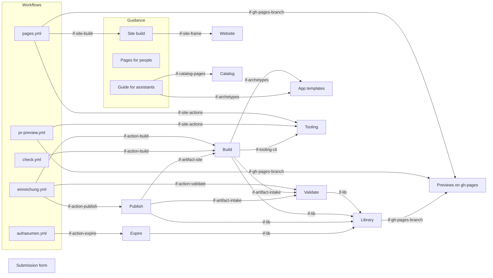

# Building Blocks

The repository holds the form, the workflows that run a submission and a cleanup, the actions with the logic, the
documentation with the guide for assistants, and the site the previews live below. It holds no app and no runtime.
Neighbours supply what it does not hold: the explainer template, the checks, the site frame and the catalog.
They are black boxes here; the [architecture of the whole system](https://lernapps.net/docs/architecture/) names them
and their interfaces.

Together the blocks below refine the building block "Practice" of the system architecture. The interfaces that the
system architecture shows keep their names: `if-practice-form`, `if-practice-previews` and `if-practice-guidance`.

Paths are relative to the root of `lernapps/practice`.

## Level 1

The flow runs from the form through the workflows and actions to the branch `gh-pages`. Artifacts pass between the
actions as data; the library reads and writes everything that comes from outside. The neighbours are at the edge.

```arc42
:::ignore H018 one picture shows the flow from the form to the branch, with the groups drawn around their parts :::
:::diagram
id: building-blocks-level-1
view: building-block
notation: mermaid
:::
```



## Submission form

The GitHub issue form with the fields subject, grade, federal state, the ZIP file and the declarations. Its field ids
and lists are fixed; `actions/lib/limits.ts` holds the same lists and a test compares them. GitHub writes each field
as a heading with its value into the issue, and that text is all the intake reads. Blank issues are switched off, so
every issue is a submission or is ignored.

```arc42
:::building-block
id: bb-form
title: Submission form
technology: GitHub issue form (YAML)
path: .github/ISSUE_TEMPLATE
:::
```

### Form interface

The contract with the parent: the fields of the form and the attachment, and the comments that answer in the same issue.

```arc42
:::interface
id: if-practice-form
title: Submission form
provider: bb-form
protocol: GitHub issue form with the content as a ZIP attachment; results as comments on the issue
path: .github/ISSUE_TEMPLATE/einreichen.yml
:::
```

## Workflows

The files GitHub reads to start work. They are thin: each one names a trigger, the rights of its jobs and the actions
to call. Text from an issue never stands in a `run:` step; it reaches scripts only as files and environment
variables.

```arc42
:::building-block
id: bb-workflows
title: Workflows
technology: GitHub Actions workflows (YAML)
path: .github/workflows
:::
```

### Workflow events

What GitHub and the maintainers use to start the workflows.

```arc42
:::interface
id: if-workflows
title: Workflow events
provider: bb-workflows
protocol: GitHub events issues opened, edited and closed, a daily schedule, workflow_dispatch with an issue number
path: .github/workflows
:::
```

### Submission workflow

`einreichung.yml`. On an issue that was opened or edited, or by hand for an issue number, it runs the jobs `intake`,
`build` and `publish` one after the other. Every job has the least rights it needs (concept `concept-rights-split`).
Runs for one issue cancel each other; the writing job joins the group that serialises writes to `gh-pages`.

```arc42
:::building-block
id: bb-workflow-submission
title: Submission workflow
technology: GitHub Actions workflow
parent: bb-workflows
path: .github/workflows/einreichung.yml
requires: if-action-validate, if-action-build, if-action-publish
implements: concept-rights-split
:::
```

### Cleanup workflow

`aufraeumen.yml`. A daily run, a run when an issue is closed and a manual run, by default a dry run that only
prints what it would delete.

```arc42
:::building-block
id: bb-workflow-cleanup
title: Cleanup workflow
technology: GitHub Actions workflow
parent: bb-workflows
path: .github/workflows/aufraeumen.yml
requires: if-action-expire
implements: concept-temporary-preview
:::
```

### Pages workflow

`pages.yml`. Builds and checks the site of this repository and, on the main line, publishes it to the root of
`gh-pages`, leaving `i/` and `pr-preview/` alone. It uses the shared site actions of the tooling.

```arc42
:::building-block
id: bb-workflow-pages
title: Pages workflow
technology: GitHub Actions workflow
parent: bb-workflows
path: .github/workflows/pages.yml
requires: if-site-actions, if-site-build, if-gh-pages-branch
:::
```

### Pull request preview workflow

`pr-preview.yml`. A preview of the site for each pull request from the same repository, below `pr-preview/` on
`gh-pages`, with the shared site action of the tooling. A pull request from a fork gets none.

```arc42
:::building-block
id: bb-workflow-pr-preview
title: Pull request preview workflow
technology: GitHub Actions workflow
parent: bb-workflows
path: .github/workflows/pr-preview.yml
requires: if-site-actions, if-gh-pages-branch
:::
```

### Check workflow

`check.yml`. Runs the tests, builds a minimal fixture the way a submission is built, and lints the workflows. The job
`check` always reports and is the one check to require.

```arc42
:::building-block
id: bb-workflow-check
title: Check workflow
technology: GitHub Actions workflow, node:test, actionlint
parent: bb-workflows
path: .github/workflows/check.yml
requires: if-action-build
:::
```

## Actions

Local composite actions that hold the logic of a submission. Each has an `action.yml` and one script in TypeScript; they share the library. Each runs in the job the workflow gives it and has only the rights of that job.

## Validate

The intake. It reads the issue, accepts only an attachment address of the form
`github.com/user-attachments/files/<number>/<name>.zip`, downloads it with limits, checks the directory of the ZIP
file and unpacks it into a throwaway folder. It writes nothing to GitHub. It stops when the ZIP address and the fields
equal those of the last run that got a comment, unless the run is forced.

```arc42
:::building-block
id: bb-action-validate
title: Validate
technology: Composite action, TypeScript (actions/validate)
path: actions/validate
requires: if-lib
implements: concept-bounded-input, concept-content-is-data
:::
```

### Validate interface

How a workflow calls the intake.

```arc42
:::interface
id: if-action-validate
title: Validate action
provider: bb-action-validate
protocol: Composite action; input issue number, force; outputs relevant, ok, unchanged
path: actions/validate/action.yml
:::
```

### Intake artifact

What the intake hands on: the verdict and, for a valid submission, the unpacked files. The jobs after it read these as data.

```arc42
:::interface
id: if-artifact-intake
title: Intake artifact
provider: bb-action-validate
protocol: Workflow artifact intake: result.json always, meta.json and tree/src/ for a valid submission
path: actions/validate/validate.ts
:::
```

## Build

Takes the template at the pinned commit, replaces its `src/` with the submitted tree and keeps the template's
`main.ts`. It installs with `npm ci`, builds, runs `lernapps check` on the bundle and marks every page `noindex`
after the check. It has no secret and no right to write. It runs the template's tools on the data files; the content is
not run as a program.

```arc42
:::building-block
id: bb-action-build
title: Build
technology: Composite action, TypeScript (actions/build), npm, Playwright via lernapps check
path: actions/build
requires: if-lib, if-artifact-intake, if-archetypes, if-tooling-cli
implements: concept-content-is-data
:::
```

### Build interface

How a workflow calls the build.

```arc42
:::interface
id: if-action-build
title: Build action
provider: bb-action-build
protocol: Composite action; reads the artifact intake; no input but the pin in package.json
path: actions/build/action.yml
:::
```

### Site artifact

What the build hands on: the bundle only when the build and the check passed, and the head of its log always.

```arc42
:::interface
id: if-artifact-site
title: Site artifact
provider: bb-action-build
protocol: Workflow artifacts site (the bundle, only when the build passed) and build (build.json with the log)
path: actions/build/build.ts
:::
```

## Publish

The last job. It runs code of this repository only and treats the artifacts as data. It turns a rejection or a failed
build into a comment. For a built site it checks again the number and size of the files, the names, the endings and
`noindex` on every page, writes `i/<issue>/` and `practice.json` to `gh-pages`, waits until the address serves the
build and comments the link. One comment per issue is updated in place.

```arc42
:::building-block
id: bb-action-publish
title: Publish
technology: Composite action, TypeScript (actions/publish)
path: actions/publish
requires: if-lib, if-artifact-intake, if-artifact-site
implements: concept-rights-split, concept-temporary-preview
:::
```

### Publish interface

How a workflow calls the last job.

```arc42
:::interface
id: if-action-publish
title: Publish action
provider: bb-action-publish
protocol: Composite action; input issue number and result of the job build; writes gh-pages and the comment
path: actions/publish/action.yml
:::
```

## Expire

Decides for each folder `i/<n>/` whether the preview is over and removes the ones that are. The rules are in
concept `concept-temporary-preview`. It reads the day from `practice.json`, never from the time of a commit.

```arc42
:::building-block
id: bb-action-expire
title: Expire
technology: Composite action, TypeScript (actions/expire)
path: actions/expire
requires: if-lib
implements: concept-temporary-preview
:::
```

### Expire interface

How the cleanup workflow calls the expiry.

```arc42
:::interface
id: if-action-expire
title: Expire action
provider: bb-action-expire
protocol: Composite action; input optional issue number and dry-run; writes gh-pages and notes in issues
path: actions/expire/action.yml
:::
```

## Library

The code the actions share: reading a ZIP file without trusting it, reading the text of an issue from the form, the
few calls of the GitHub API with the texts of the comments, the limits in one file and the writing of `gh-pages` as a
single commit. It uses only Node's own modules and the git command line.

```arc42
:::building-block
id: bb-lib
title: Library
technology: TypeScript on Node.js, git
path: actions/lib
requires: if-gh-pages-branch
implements: concept-bounded-input, concept-temporary-preview
:::
```

### Library interface

The functions the actions import; the tests call them directly.

```arc42
:::interface
id: if-lib
title: Library
provider: bb-lib
protocol: TypeScript modules imported by the actions
path: actions/lib
:::
```

## Previews on gh-pages

The branch `gh-pages`, which GitHub Pages serves. It holds the site at its root, the previews of submissions below
`i/<issue number>/` and the previews of pull requests below `pr-preview/pr-<number>/`. Each writer touches its own
part only. Every change of `i/` is one new commit without a parent.

```arc42
:::ignore H014 served by GitHub Pages from the branch gh-pages; no file of this repository implements it :::
:::building-block
id: bb-previews
title: Previews on gh-pages
technology: Git branch, GitHub Pages
implements: concept-temporary-preview, concept-nothing-stored
:::
```

### Preview pages

The temporary app of each submission below its issue number, with `practice.json` beside it. A preview ends after two
weeks or when its issue is closed, unless a person has reacted to the issue with a thumbs-up.

```arc42
:::ignore H014 served by GitHub Pages from the branch gh-pages; no file of this repository implements it :::
:::interface
id: if-practice-previews
title: Preview pages
provider: bb-previews
protocol: HTTPS pages under lernapps.net/practice/i/<issue number>/
:::
```

### Pages branch

How the branch is written: a fresh copy, one change, one commit without a parent, a push with a lease against the state the copy started from.

```arc42
:::interface
id: if-gh-pages-branch
title: Pages branch
provider: bb-previews
protocol: git branch gh-pages; the root for the site, i/ for submissions, pr-preview/ for pull requests
path: actions/lib/pages.ts
:::
```

## Guidance

The pages for families and maintainers in German and English, the guide for assistants and the build that turns them
into the site.

```arc42
:::building-block
id: bb-guidance
title: Guidance
technology: Markdown, marked, Node.js
path: docs
:::
```

### Guidance interface

What the family's assistant and the parent read.

```arc42
:::interface
id: if-practice-guidance
title: Practice guidance
provider: bb-guidance
protocol: Markdown pages and llms.txt under lernapps.net/practice/
path: docs/llms.txt
:::
```

### Guide for assistants

`docs/llms.txt`, in German. It leads the family's assistant through the preparation: ask, look in the catalog, warn
the parents, read the photos, agree the scope, write the content, zip it and hand it over. It names the limits of a
ZIP file and the stumbling blocks of the explainer's YAML.

```arc42
:::building-block
id: bb-assistant-guide
title: Guide for assistants
technology: Plain text
parent: bb-guidance
path: docs/llms.txt
requires: if-catalog-pages, if-archetypes
:::
```

### Pages for people

The Markdown pages: the overview, the steps, the rules for content, the checks, the lifetime of a preview, privacy and
copyright, and operations for maintainers. The German pages are at the root and the English pages below `en/`, with
the same file names and anchors.

```arc42
:::ignore H014 its files are the Markdown files in docs/ and docs/en/, which the path of the block Guidance covers :::
:::ignore W002 its interface is the one of the block Guidance :::
:::building-block
id: bb-documentation
title: Pages for people
technology: Markdown
parent: bb-guidance
:::
```

### Site build

`scripts/build.sh` renders the pages (`scripts/pages.mjs`), builds the architecture from `docs/arc42/` into
`architecture/`, and lets the shared frame add header, footer and language switch. `scripts/frame.sh` runs the frame's
commands with this site added to the frame's list of sites. The result is the folder `_site/`.

```arc42
:::building-block
id: bb-site-build
title: Site build
technology: Bash, Node.js, marked, arc42 CLI, @lernapps/site
parent: bb-guidance
path: scripts
requires: if-site-frame
:::
```

#### Site build interface

How the site is built and checked, by a person and by the shared site actions.

```arc42
:::interface
id: if-site-build
title: Site build
provider: bb-site-build
protocol: npm run build and npm run check; output in _site/
path: scripts/build.sh
:::
```

## App templates

The explainer template and its runtime, from which every preview is built. Its own architecture refines this block:
[app-templates, chapter 5](https://github.com/lernapps/app-templates/blob/main/docs/arc42/05-building-blocks.arc42.md).

```arc42
:::ignore H014 implemented in another repository, lernapps/app-templates: https://github.com/lernapps/app-templates :::
:::building-block
id: bb-app-templates
title: App templates (lernapps/app-templates)
technology: TypeScript, Vite, Vue
x-repo: lernapps/app-templates
:::
```

### Archetypes

What the build takes: the folder `explainer/` of the template, and the root that its dependency `file:..` needs.

```arc42
:::ignore H014 implemented in another repository, lernapps/app-templates: https://github.com/lernapps/app-templates :::
:::interface
id: if-archetypes
title: Archetypes
provider: bb-app-templates
protocol: git repository at the commit that appTemplates.commit pins
:::
```

## Tooling

The `lernapps check` command, which checks a built bundle against the rules of the platform, and the shared actions
for the site. Its own architecture refines this block:
[tooling, chapter 5](https://github.com/lernapps/tooling/blob/main/docs/arc42/05-building-blocks.arc42.md).

```arc42
:::ignore H014 implemented in another repository, lernapps/tooling: https://github.com/lernapps/tooling :::
:::building-block
id: bb-tooling
title: Tooling (lernapps/tooling)
technology: TypeScript, GitHub actions
x-repo: lernapps/tooling
:::
```

### Tooling CLI

What the build calls on the bundle.

```arc42
:::ignore H014 implemented in another repository, lernapps/tooling: https://github.com/lernapps/tooling :::
:::interface
id: if-tooling-cli
title: Tooling CLI
provider: bb-tooling
protocol: lernapps check <folder> from the package that the template's lock file pins
:::
```

### Site actions

What the pages workflow and the pull request preview workflow call.

```arc42
:::ignore H014 implemented in another repository, lernapps/tooling: https://github.com/lernapps/tooling :::
:::interface
id: if-site-actions
title: Site actions
provider: bb-tooling
protocol: GitHub actions and a reusable workflow, pinned to a commit
:::
```

## Website

The shared site frame that gives every page its header, footer and language switch, and its check of the site rules.

```arc42
:::ignore H014 implemented in another repository, lernapps/lernapps.github.io: https://github.com/lernapps/lernapps.github.io :::
:::building-block
id: bb-website
title: Website (lernapps.github.io)
technology: Eleventy, npm package @lernapps/site
x-repo: lernapps/lernapps.github.io
:::
```

### Site frame

What the site build calls to give each page its header, footer and language switch.

```arc42
:::ignore H014 implemented in another repository, lernapps/lernapps.github.io: https://github.com/lernapps/lernapps.github.io :::
:::interface
id: if-site-frame
title: Site frame
provider: bb-website
protocol: npm package @lernapps/site from git, pinned to a commit
:::
```

## Catalog

The pages where adults find an app for a topic and grade. The guide for assistants sends the assistant there first.

```arc42
:::ignore H014 implemented in another repository, lernapps/apps: https://github.com/lernapps/apps :::
:::building-block
id: bb-catalog
title: Catalog (lernapps/apps)
technology: Eleventy, GitHub Pages
x-repo: lernapps/apps
:::
```

### Catalog pages

What the guide links to.

```arc42
:::ignore H014 implemented in another repository, lernapps/apps: https://github.com/lernapps/apps :::
:::interface
id: if-catalog-pages
title: Catalog pages
provider: bb-catalog
protocol: HTTPS pages under lernapps.net/apps/
:::
```
