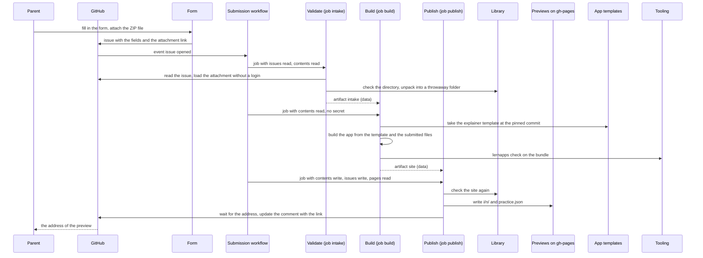
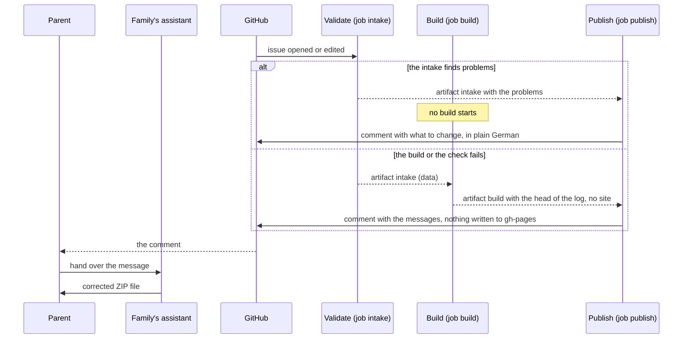
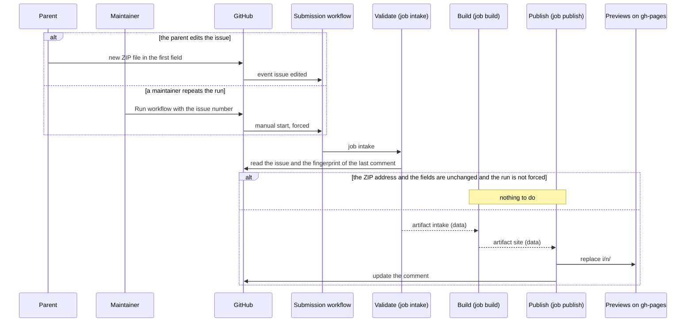
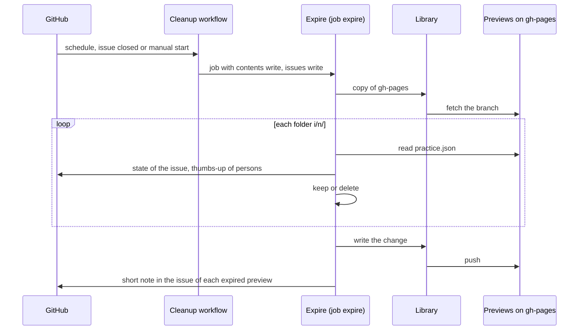
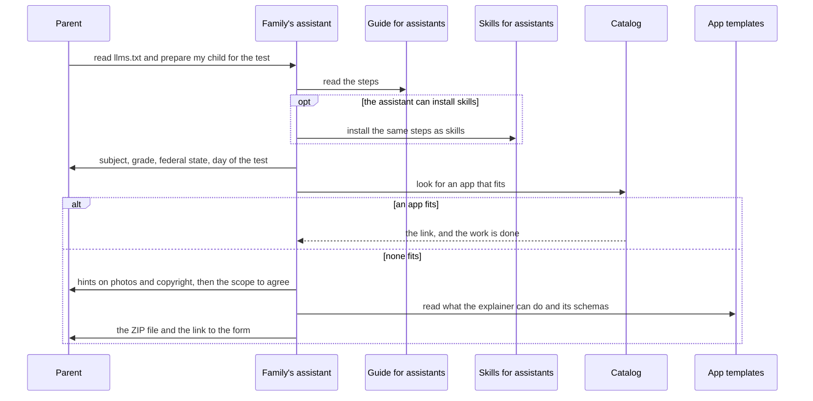
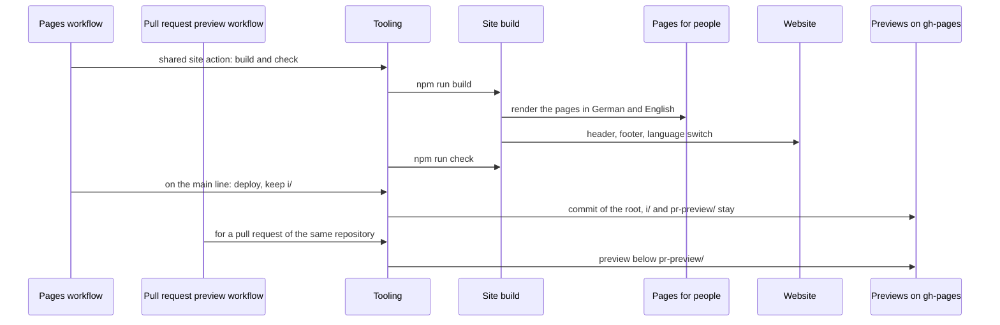

# Runtime View

The scenarios show which job holds which rights and what passes between jobs as an artifact. The
[architecture of the whole system](https://lernapps.net/docs/architecture/) shows the same flow from the family's
point of view.

## A submission becomes a preview

The parent submits the form. `intake` loads and checks the attachment, `build` makes the app, `publish` checks the site again, writes it to `gh-pages` and comments the address. The rights of each job are in `concept-rights-split`.

```arc42
:::runtime-scenario
id: rs-submission
title: A submission becomes a preview
trigger: A parent submits the form with the ZIP file
involves: bb-form, bb-workflows, bb-workflow-submission, bb-action-validate, bb-action-build, bb-action-publish, bb-lib, bb-previews, bb-app-templates, bb-tooling
:::
```

```arc42
:::diagram
id: rs-submission-sequence
scenario: rs-submission
notation: mermaid-sequence
aliases: parent=actor-adopting-adult, github=actor-github, form=bb-form, flow=bb-workflow-submission, intake=bb-action-validate, build=bb-action-build, publish=bb-action-publish, lib=bb-lib, previews=bb-previews, templates=bb-app-templates, tooling=bb-tooling
:::
```



## A rejected submission, with a message

A problem found by the intake, or a failed build or check, ends in a comment that the parent hands to the assistant; nothing is written to `gh-pages`.

```arc42
:::runtime-scenario
id: rs-rejection
title: A rejected submission, with a message
trigger: The intake finds a problem, or the build or the check of the bundle fails
involves: bb-workflow-submission, bb-action-validate, bb-action-build, bb-action-publish, bb-lib
:::
```

```arc42
:::diagram
id: rs-rejection-sequence
scenario: rs-rejection
notation: mermaid-sequence
aliases: parent=actor-adopting-adult, assistant=actor-family-assistant, github=actor-github, intake=bb-action-validate, build=bb-action-build, publish=bb-action-publish
:::
```



## A run is repeated

An edited issue starts the workflow again; a maintainer can start it by hand with the issue number, which forces a build. The intake stops when the fingerprint is unchanged (`term-fingerprint`). A new preview replaces the old folder and starts its days again.

```arc42
:::runtime-scenario
id: rs-run-again
title: A run is repeated
trigger: The issue is edited with a new ZIP file, or a maintainer starts the workflow for an issue number
involves: bb-workflow-submission, bb-action-validate, bb-action-build, bb-action-publish, bb-previews
:::
```

```arc42
:::diagram
id: rs-run-again-sequence
scenario: rs-run-again
notation: mermaid-sequence
aliases: parent=actor-adopting-adult, maintainer=actor-practice-maintainer, github=actor-github, flow=bb-workflow-submission, intake=bb-action-validate, build=bb-action-build, publish=bb-action-publish, previews=bb-previews
:::
```



## A preview ends

The cleanup reads `practice.json` of each folder `i/<n>/`, asks GitHub for the issue and the thumbs-up, and removes what is over by `concept-temporary-preview`. If another writer was faster, it starts again on the new state.

```arc42
:::runtime-scenario
id: rs-expiry
title: A preview ends
trigger: The daily schedule, a closed issue or a manual start of the cleanup
involves: bb-workflow-cleanup, bb-action-expire, bb-lib, bb-previews
:::
```

```arc42
:::diagram
id: rs-expiry-sequence
scenario: rs-expiry
notation: mermaid-sequence
aliases: github=actor-github, cleanup=bb-workflow-cleanup, expire=bb-action-expire, lib=bb-lib, previews=bb-previews
:::
```



## The assistant prepares the content

The assistant reads the guide, looks in the catalog first and otherwise agrees the scope with the parent, writes the content and hands over the ZIP file and the link to the form. The steps are in the skills (`bb-assistant-skills`).

```arc42
:::runtime-scenario
id: rs-preparation
title: The assistant prepares the content
trigger: A parent tells their assistant to read the guide and to prepare their child for a test
involves: bb-guidance, bb-assistant-guide, bb-assistant-skills, bb-catalog, bb-app-templates
:::
```

```arc42
:::diagram
id: rs-preparation-sequence
scenario: rs-preparation
notation: mermaid-sequence
aliases: parent=actor-adopting-adult, assistant=actor-family-assistant, guide=bb-assistant-guide, skills=bb-assistant-skills, catalog=bb-catalog, templates=bb-app-templates
:::
```



## The site is published

A change of the pages, the guide or the build goes through the pages workflow; a pull request from the same repository gets a preview. The writers of `gh-pages` are in chapter 7.

```arc42
:::runtime-scenario
id: rs-site-published
title: The site is published
trigger: A change of the pages, the guide or the build reaches the main line, or a pull request is opened
involves: bb-workflow-pages, bb-workflow-pr-preview, bb-site-build, bb-documentation, bb-tooling, bb-website, bb-previews
:::
```

```arc42
:::diagram
id: rs-site-published-sequence
scenario: rs-site-published
notation: mermaid-sequence
aliases: pages=bb-workflow-pages, preview=bb-workflow-pr-preview, build=bb-site-build, docs=bb-documentation, tooling=bb-tooling, frame=bb-website, branch=bb-previews
:::
```


