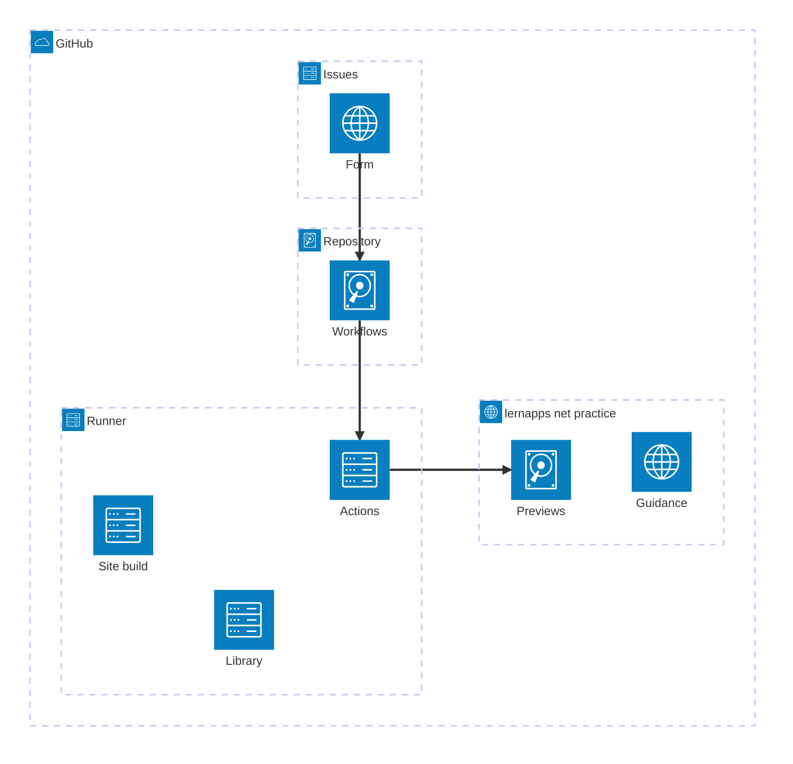

# Deployment View

Practice has no server of its own (`con-github`): its source is one repository, its logic runs on GitHub-hosted
runners, and what it produces is static files on the branch `gh-pages`. The
[architecture of the whole system](https://lernapps.net/docs/architecture/) shows the address as one node of the
platform.

## Deployment overview

```arc42
:::diagram
id: deployment-overview
view: deployment
notation: mermaid-architecture
aliases: env_github=env-github, dn_issues=dn-issues, dn_repository=dn-repository, dn_runner=dn-runner, dn_pages_practice=dn-pages-practice, bb_form=bb-form, bb_workflows=bb-workflow-submission, bb_actions=bb-action-build, bb_lib=bb-lib, bb_site_build=bb-site-build, bb_previews=bb-previews, bb_guidance=bb-documentation
:::
```



## GitHub

The settings that matter (Issues, Pages from the branch `gh-pages`, required checks) are in [docs/betrieb.md](../betrieb.md).

```arc42
:::deployment-node
id: env-github
title: GitHub
type: environment
:::
```

### Issues

The form is served as the issue form of the repository. The ZIP files stay as attachments of the issues.

```arc42
:::deployment-node
id: dn-issues
title: Issues of the repository
type: server
parent: env-github
hosts: bb-form
:::
```

### Repository

The main line holds the source of every block and the workflows, with the pins of other repositories.

```arc42
:::deployment-node
id: dn-repository
title: Repository lernapps/practice
type: server
parent: env-github
hosts: bb-workflow-submission, bb-workflow-cleanup, bb-workflow-pages, bb-workflow-pr-preview, bb-workflow-check, bb-assistant-skills, bb-plan-template
:::
```

### Runner

Each job runs on a GitHub-hosted Linux runner and is gone afterwards. The runners are the only place where submitted files are unpacked and built.

```arc42
:::deployment-node
id: dn-runner
title: GitHub-hosted runner
type: container
parent: env-github
hosts: bb-action-validate, bb-action-build, bb-action-publish, bb-action-expire, bb-lib, bb-site-build, bb-trial-run
:::
```

### lernapps.net/practice

GitHub Pages serves the branch `gh-pages` here, in three parts with one writer each:

| Path on `gh-pages` | Content | Written by |
|---|---|---|
| root | the site | the pages workflow, which leaves the other two parts alone |
| `i/<issue number>/` | one preview and its `practice.json` | publish and expire |
| `pr-preview/pr-<number>/` | the preview of a pull request | the pull request preview workflow |

```arc42
:::deployment-node
id: dn-pages-practice
title: lernapps.net/practice
type: server
parent: env-github
hosts: bb-previews, bb-assistant-guide, bb-documentation
:::
```

### Neighbouring repositories

The repositories and sites of the neighbours, which are black boxes here.

```arc42
:::deployment-node
id: dn-neighbours
title: Repositories and sites of the neighbours
type: server
parent: env-github
hosts: bb-app-templates, bb-tooling, bb-website, bb-catalog
:::
```
